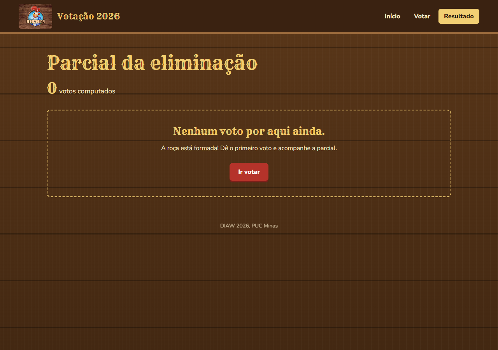
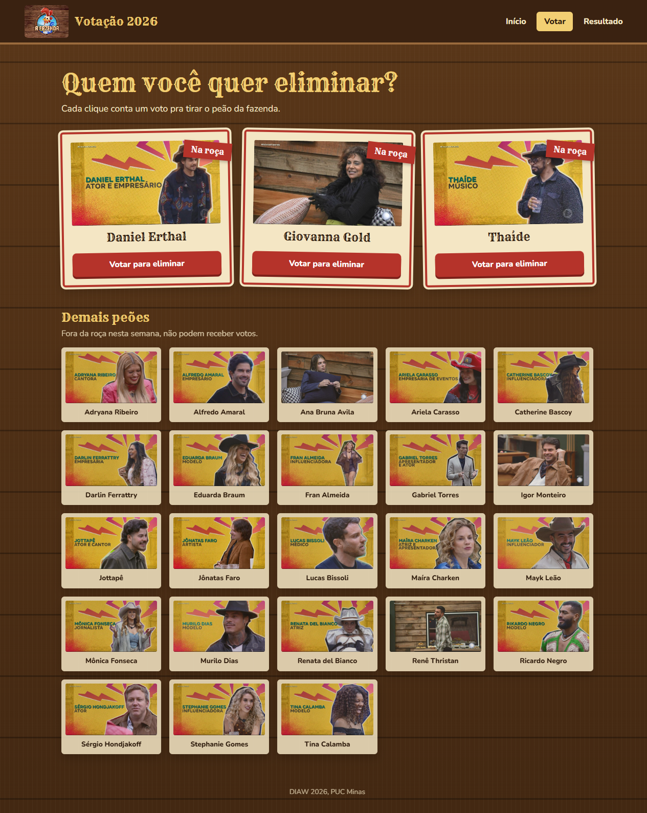
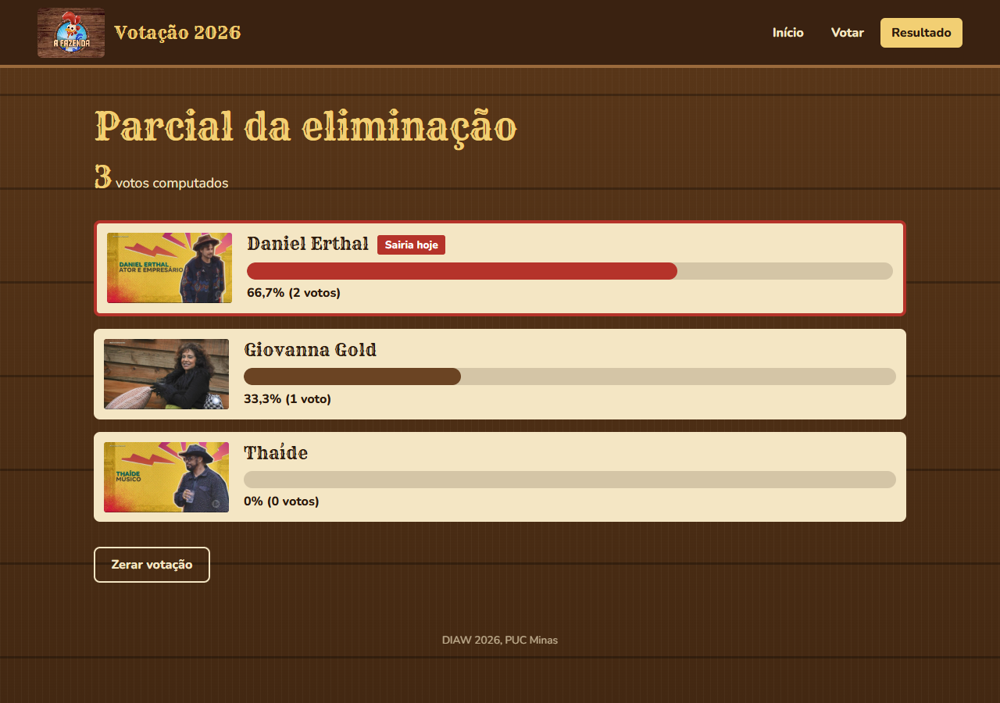

# Votação A Fazenda 2026

Aplicação da disciplina Desenvolvimento de Interfaces e Aplicações Web, feita com React, Vite e React Router.

## Como rodar

Com o Node.js instalado:

```sh
npm install
npm run dev
```

Abra http://localhost:5173/. Para gerar a versão de produção, use `npm run build`. Para conferir o código, use `npm run lint`.

## Páginas

- `/`: apresentação e participantes da roça.
- `/votacao`: voto para eliminar Daniel Erthal, Giovanna Gold ou Thaíde e lista dos demais participantes.
- `/resultado`: total de votos, percentuais, placar em ordem decrescente e opção de zerar a votação com confirmação.

Cada clique registra um voto. A confirmação mostra o último participante escolhido e quantas vezes você votou desde que abriu a página de votação.

Os votos ficam no localStorage do navegador, na chave `fazenda2026:votos`. A contagem permanece ao recarregar a página, mas não é compartilhada entre navegadores ou computadores. O serviço, os dados dos participantes, o cabeçalho, a Home e os estilos globais vieram dos arquivos auxiliares da atividade.

## Organização

```text
public/
  fonts/
  participantes/
src/
  components/
    Header.jsx
    ParticipanteCard.jsx
  data/participantes.js
  pages/
    Home.jsx
    Votacao.jsx
    Resultado.jsx
  services/votacaoService.js
  App.jsx
  App.css
  index.css
  main.jsx
```

## Telas







